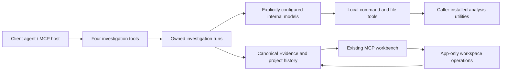

# REA MCP App restart

The client submits an investigation. REA's own configured agents perform the
analysis, operate local tools, retain Evidence, and return findings. The client
does not perform the investigation on REA's behalf.

`leanrea/SKILL.md` is the investigation guide. It is not an execution engine.
Its command recipes run through an owned local process boundary inside REA.
The upstream skill and benchmark are retained with their original attribution;
their macOS results do not establish this implementation's performance or parity.

## Boundaries

The four model-facing tools are `rea_workbench`, `start_investigation`,
`read_investigation`, and `cancel_investigation`. Existing workspace operations
are App-only, with named contracts. There is no hidden copy of the 180-tool MCP
server and no dependency on `npx rea-agents`.

The October 30 capability expansion deliberately retains selected semantic
parser/graph, Ghidra protocol and browser scenario services, recorded in
`capability-source-manifest.json`. Their private protocols are not advertised
to clients or copied wholesale into internal model tool definitions. Internal
outcome contracts are authored in `src/analysis/contracts.ts`; the public
catalog stays at four model-facing tools. New device and browser launches use
the retained ownership boundary, not PID cleanup.

Internal agent tools operate on the selected run workspace. They provide command
execution, focused file reads/writes, directory inspection, and retained Evidence
inspection. The skill supplies target-specific routes, rather than registering
one model tool for every external program. Command execution has real process
ownership, cancellation, output limits, and explicit partial failure.

The local process boundary is not an OS sandbox. External utilities run with the
launching user's permissions. REA prepares a working copy of selected local
targets and does not pass model credentials to analysis processes. It does not
automatically install analysis utilities or unrelated runtimes. Ghidra remains
ephemeral; attached IDA GUI databases remain read-only and open.

## Preservation map

| Current capability                                              | Restart treatment                                                                                                                        |
| --------------------------------------------------------------- | ---------------------------------------------------------------------------------------------------------------------------------------- |
| Internal analyst, reviewer and optional specialists             | Retain explicit model configuration and inferred reports; give executors local analysis tools instead of only two retained/native probes |
| Start/read/cancel and complete report export                    | Preserve connection-owned runs, source pagination, partial reports and cancellation draining                                             |
| Slate, blue/violet/amber/rose UI                                | Carry over existing source and styling                                                                                                   |
| Light/dark themes, safe areas and fullscreen/browser continuity | Carry over existing bridge and restricted loopback handoff                                                                               |
| Evidence provenance, digests, raw results and uncertainty       | Retain canonical semantics; local command observations identify exact commands, outputs and limits                                       |
| Durable feature projects and historical jobs                    | Retain schema, SQLite revisions, conflict checks and existing verification ownership                                                     |
| Comparisons, finite verification and handoff export             | Retain existing application/domain services; a model report cannot mark a case verified                                                  |
| Code, relationships and Unknown views                           | Preserve views; adapt them to direct-tool observations and existing imported Evidence                                                    |
| Main-agent build/capture handoff                                | Replace investigation work requests with internal assignments; keep discussion/export as host interactions                               |
| Original 180-tool registration/provider layer                   | Exclude from the new application                                                                                                         |
| Native and platform analysis                                    | Execute installed utilities using skill routes; report missing capabilities and unverified provider lanes explicitly                     |

Reusable Evidence/project/process code is selected by an import dependency
closure, recorded with source digests. The measured initial closure is 212
TypeScript files / 1,402,916 source bytes. It contains shared semantics, not the
original provider adapters or server registration. Retaining it avoids inventing
a second Evidence format or silently weakening saved proof checks.

## Acceptance

Track broad target requirements and current gaps in
[`capability-parity.json`](capability-parity.json). The repeatable
[`verify:parity` assessment](capability-parity.md) compares finite tasks and
measures actual catalogs/package payloads; its strict gate must stay incomplete
until full capability and live-model evidence exists.

1. The real stdio catalog contains exactly four model-visible tools. App-only
   workspace tools never become internal agent tools automatically.
2. One client start request leads to internal model tool calls, actual local
   process execution, authenticated Evidence, and a readable report. No client
   analysis calls intervene.
3. Cancellation drains owned processes; failed cleanup retains its owner and
   blocks conflicting new execution. Deadlines and output limits remain partial.
4. Existing project/bundle fixtures round-trip without changing source identities;
   stale revisions, altered Evidence and fabricated verification fail.
5. Workbench actions, themes, narrow layouts and fullscreen are exercised through
   a real browser/host boundary. Fixture models establish runtime plumbing only.
6. Record tool-definition bytes, model context, turns and elapsed time against the
   original on matching tasks. Do not claim equal power or efficiency from tool
   count alone. Paid-model and real-provider acceptance are separate evidence.

The original application remains intact during the port. Existing runtime data,
secrets and unrelated source are excluded. A verified Windows authority component
is staged only as ignored local build output and explicitly included in package
artifacts; its source and license are retained. No binary is committed as source.
